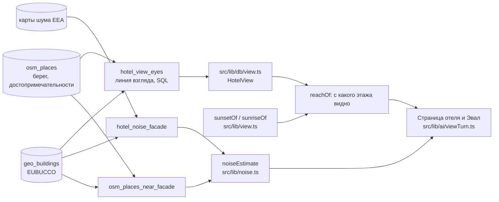
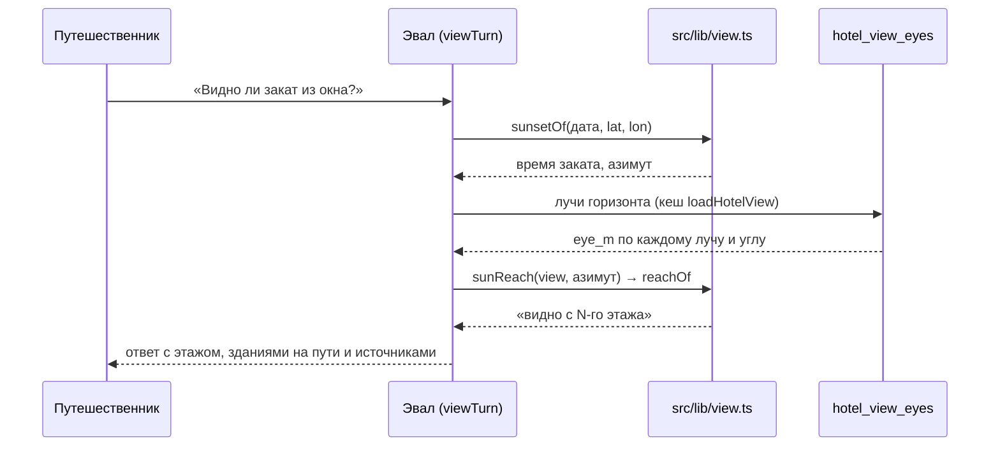

# Геометрические методы: солнце, линия взгляда, шум

Как считаются ответы Эвала и блоков «Вид из отеля» и «Шум и окружение». Расчёты есть у настоящих отелей Валенсии
(`ota-<master_id>`); у остальных отелей Эвал отвечает «нет данных». Таблицы утверждений и инструменты —
в [«Знания и поиск»](retrieval.md#1-kag-граф-знаний).

Параметры модели — это её определение: рельеф, деревья и стёкла в модель не входят, здания берутся из EUBUCCO, шум — из
карт EEA и точечных источников OSM. Результат — оценка по этим данным, и в ответе она подписана как оценка (`≈`, полосы дБ).



## 5. Положение солнца

Алгоритм — приближение NOAA положения Солнца (`sunPosition` в `src/lib/view.ts`), без внешней библиотеки. Функция берёт
момент времени, широту и долготу и возвращает высоту над горизонтом и азимут (градусы по часовой от севера).

Формулы (`n` — дни от эпохи J2000.0, `n = unixMs / 86 400 000 + 2 440 587,5 − 2 451 545`):

```
L  = 280,46 + 0,9856474·n                      средняя долгота Солнца, °
g  = 357,528 + 0,9856003·n                     средняя аномалия, °
λ  = L + 1,915·sin g + 0,02·sin 2g             эклиптическая долгота
ε  = 23,439 − 0,0000004·n                      наклон эклиптики
α  = atan2(cos ε · sin λ, cos λ)               прямое восхождение
δ  = asin(sin ε · sin λ)                       склонение
θ  = 280,46061837 + 360,98564736629·n + lon    звёздное время места
H  = θ − α                                     часовой угол
h  = asin(sin φ · sin δ + cos φ · cos δ · cos H)             высота
A  = atan2(sin H, cos H · sin φ − tan δ · cos φ) + 180°      азимут от севера
```

Точность приближения — около 0,01°, этого хватает для окна.

**Закат и восход** (`sunsetOf`, `sunriseOf`): метод шагает по минутам от местного полудня (в UTC: `12 − lon/15` ч) и находит
первую минуту, когда высота Солнца ниже порога.

| Параметр            | Значение                                                                                 |
| ------------------- | ---------------------------------------------------------------------------------------- |
| Закат/восход        | высота `−0,833°` (верхний край диска касается горизонта, с рефракцией, как в альманахах) |
| Проверка видимости  | высота `SUN_CHECK_ALTITUDE_DEG` = 2°: за 10–15 минут до заката и после восхода           |
| Диапазон за год     | `sunsetRange`/`sunriseRange`: азимуты в дни солнцестояний, 21 декабря и 21 июня          |
| Часовой пояс ответа | `Europe/Madrid` (`VALENCIA_TIME_ZONE`)                                                   |

Для даты без заката (полярный день) функции возвращают `null`.

**Как получается «закат в 18:05 видно с 12-го этажа».** Метод считает закат на дату (время и азимут), берёт ближайший луч
горизонта к азимуту (лучи идут каждые 3°, длина 1500 м) и для этого луча проверяет окно этажа с двумя углами: 0° (крыши) и
2° (Солнце за 10–15 минут до заката). Ближайший этаж, с которого линия проходит над всеми зданиями на луче под углом 2°, и
есть «видно с N-го этажа» (подробности — раздел 6). Если Солнце на 2° видно, а под углом 0° его закрывают крыши, итог —
«частично закрыто».



## 6. Линия взгляда до точки

Расчёт — SQL-функция `hotel_view_eyes(lat, lon, targets jsonb)` (`20261027150000_hotel_view_eyes.sql`, границы доверия
высот и покрытие — `20261027170000_hotel_view_coverage.sql`). Она читает только `geo_buildings` (EUBUCCO) и ничего не пишет.
Результат читает `src/lib/db/view.ts`, решения принимает `src/lib/view.ts`; страница и Эвал используют одни функции.

### Геометрия

```
                      цель (берег, достопримечательность, луч горизонта)
                  .  ´
   высота над   .´    ← линия взгляда: проходит над всеми зданиями
   землёй     .´   ┌──┐ здание i: расстояние d, вершина h' = h − d²/(2R')
       eye ●´      │  │
  окно ▒▒  │       │  │
  этаж k   │ ░░░░░ │  │ ░░░░░░░░░░░░░░░░░░░░
  ─────────┴───────┴──┴──────────────────────  земля (плоская)
  отель       d  →
```

- Окно: этаж `k` даёт глаз на высоте `(k − 1)·storey + 1,5 м` над землёй (`eyeOf`, `EYE_ABOVE_FLOOR_M` = 1,5 м).
  `storey` — высота здания отеля EUBUCCO, делённая на число этажей; без точных данных здания — этажи номеров Островка с
  этажом `TYPICAL_STOREY_M` = 3 м (медиана по зданиям Валенсии с измеренной высотой).
- Линия: прямая от точки отеля до цели, не длиннее 6 км, до 160 линий за вызов. Здания, которые она пересекает, берутся
  без здания отеля (ближайшего в 50 м) и без здания в точке цели.
- Кривизна Земли с рефракцией (`k = 0,13`): `R' = 6 371 км / (1 − 0,13)`, точка на расстоянии `d` опускается на
  `d² / (2R')`; вершина здания `h' = h − d² / (2R')`.
- Земля плоская: рельефа в данных EUBUCCO нет.

### Минимальная высота глаза

Для каждого здания на линии функция считает `eye_m` — наименьшую высоту глаза, с которой линия идёт над ним. Здание
мешает глазу `e`, пока `e ≤ eye_m`.

| Цель            | Формула                                                                                        |
| --------------- | ---------------------------------------------------------------------------------------------- |
| точка (`point`) | `eye = (D·h' − d·ht') / (D − d)`, где `ht'` — вершина здания цели на расстоянии `D`            |
| луч горизонта   | под углом `α` к горизонтали: `eye = h' − d·tan α`; углы `RAY_ANGLES` = 0° (крыши), 2° (Солнце) |
| море (`sea`)    | `c = d·√(2/R')`, `eye = ((c + √(c² + 4h')) / 2)²`; ноль при `c² + 4h' < 0`                     |

Для моря учтён горизонт моря: он лежит на `√(2e/R')` ниже горизонтали, поэтому дальнее здание закрывает море, только если
оно выше этой линии. Функция берёт максимум `eye_m` по зданиям линии. Три значения на линию: по высоте EUBUCCO (`eye_m`),
по нижней (`eye_lower_m`) и верхней (`eye_upper_m`) границам доверительного интервала высоты. Блок `blockers` — здания с
наибольшим `eye_upper_m` (5 штук) и с наибольшим `eye_m`.

### Вердикты и этажи

`lineVerdict(line, eyeM, angle)` сравнивает глаз с тремя порогами:

| Условие                          | Вердикт                                                       |
| -------------------------------- | ------------------------------------------------------------- |
| `eye ≤ eye_lower_m`              | «закрыто»                                                     |
| `eye ≤ eye_m`                    | «вероятно, закрыто»                                           |
| линия выходит за покрытие данных | «нет данных»                                                  |
| `eye ≤ eye_upper_m`              | «возможно, закрыто»                                           |
| иначе                            | «видно» (для Солнца при закрытых крышах — «частично закрыто») |

`reachOf` проходит этажи окна снизу вверх и находит первый с «видно» или «частично закрыто»: он и есть «видно с N-го
этажа» (первый этаж — «со всех этажей»). Если ни один этаж не видит цель, верхний этаж с «возможно, закрыто» даёт «возможно,
видно с N-го этажа», закрытый верх — «не видно ни с одного этажа». Фраза «закрыто зданием ≈ 12,4 м в 2,7 км» собирается из
`blockers`: высота здания (со знаком `≈` для оценки модели EUBUCCO) и расстояние от отеля (`verdictReason`).

Покрытие: данные EUBUCCO есть по всему муниципалитету València (`geo_coverage`). Линия над морем, парком или руслом без
зданий — «видно». «Нет данных» только там, где линия уходит в соседний муниципалитет.

### Параметры

| Параметр              | Значение                                                                                      |
| --------------------- | --------------------------------------------------------------------------------------------- |
| Лучи горизонта        | каждые `RAY_STEP_DEG` = 3° (120 лучей), длина `RAY_LENGTH_M` = 1500 м                         |
| Достопримечательности | OSM и места Островка в `LANDMARK_RADIUS_M` = 3000 м                                           |
| Море                  | точки береговой линии OSM (`natural=coastline`) в `SEA_RADIUS_M` = 6000 м                     |
| Точки берега          | ближайшие по разным азимутам: не больше `MAX_SEA_POINTS` = 8, азимуты разнесены минимум на 5° |
| Линия                 | до 6 км, до 160 линий за вызов                                                                |
| Стороны окон          | 8 сторон по 45° (`SIDES`), полуширина `SIDE_HALF_WIDTH_DEG` = 22,5°                           |
| Азимут                | `bearingDeg`: сферический азимут от севера по часовой                                         |

Сторону окон номера данные не дают, поэтому модель проверяет все этажи и все стороны; путешественник выбирает сторону на
компасе, а блок «Положение окна» показывает этаж и сторону. Береговая линия — цель «моря»: линии идут к ближайшим точкам
береговой линии OSM, а «видно море» значит, что хотя бы к одной такой точке линия проходит над зданиями.

## 7. Уровни шума

Метод `noise-estimate-v2` (`noiseEstimate` в `src/lib/noise.ts`, SQL — `hotel_noise_facade`
`20261028120000_hotel_noise_facade.sql` и `osm_places_near_facade` `20261029100000_osm_places_near_facade.sql`; утверждения
пишет `estimateStore` в `src/lib/claimRows.ts`).

### Фасад: улица и двор

```
         улица  ◄── заведения OSM (200 м от стены) ──►  складываются с EEA
   ┌───────────────────────────┐
   │       ВЫСОКАЯ полоса      │   фасад на улицу: самая громкая полоса EEA
   │   ┌───────────────────┐   │   у контура здания + 5 м
   │   │      здание       │   │
   │   │  отеля (EUBUCCO)  │   │   здание экранирует двор: заведения
   │   └───────────────────┘   │   во двор вклада не дают
   │       ТИХАЯ полоса        │   окна во двор: самая тихая полоса EEA
   └───────────────────────────┘
```

Зона фасада — контур здания отеля EUBUCCO (ближайшее здание в 50 м от точки) плюс `FACADE_BUFFER_M` = 5 м; без здания —
круг `FACADE_CIRCLE_M` = 25 м вокруг точки. Точка отеля лежит внутри здания, а карты EEA здания не включают, поэтому
читается не точка, а фасад. Для каждого источника EEA (дороги, железная дорога, аэропорт, промышленность) и индикатора
(Lden, Lnight) функция возвращает самую громкую полосу, пересекающую зону, — «улица», и самую тихую — «двор».

### Карты EEA

Данные — стратегические карты шума EEA (END, раунд 2022), полосы по 5 дБ: Lden (сутки с надбавками) и Lnight (23–07).
Нижняя полоса карты — «ниже 40 дБ», верхняя может быть открытой. Отель вне контуров — «нет данных EEA», а не «тихо».
Дневной уровень Lday получается из Lden и Lnight по приложению I директивы 2002/49/EC:

```
Lden = 10·lg( (12·10^(Lday/10) + 4·10^((Levening+5)/10) + 8·10^((Lnight+10)/10)) / 24 )
```

Допущения: вечер так же громок, как день (`evening_equals_day`), день не тише ночи (`day_not_quieter_than_night`).
`dayEstimate` решает уравнение по границам полос и возвращает диапазон; при равных вечере и дне `Lden − Lday` =
`10·lg((12 + 4·√10 + 80)/24)`. Слои, у которых полосы не дают дня, не входят в дневной уровень (`noDay`).

### Заведения OSM

Заведения в `NOISY_RADIUS_M` = 200 м от стены здания (`osm_places_near_facade`; расстояние до стены, 0 для места внутри
здания) — точечные источники. Каждое входит один раз, категория — первая из списка `NOISY_CATEGORIES`.

| Категория               | день | вечер | ночь |
| ----------------------- | ---- | ----- | ---- |
| ночной клуб             | —    | 65    | 72   |
| бар, паб                | 58   | 65    | 62   |
| ресторан, кафе, фастфуд | 60   | 62    | —    |

Это типовой уровень на расстоянии `VENUE_REFERENCE_M` = 10 м (`Lref`); «—» — обычно закрыто. Уровень на фасаде:

```
L(d) = Lref − 20·lg( max(d, 3) / 10 )        d — от стены, не меньше VENUE_MIN_DISTANCE_M = 3 м
Σ    = 10·lg( Σ 10^(L/10) )                  энергетическая сумма (energySum)
```

Сумма идёт сначала по заведениям за период, затем с уровнем EEA: `Ltotal = 10·lg(10^(LEEA/10) + 10^(Lзаведений/10))`. Расчёт
ведётся для нижней и верхней границ полос, поэтому итог — диапазон; открытая верхняя граница полосы открывает сумму.
Lden заведений собирается из дня, вечера и ночи с надбавками +5 и +10 дБ (`ldenOf`).

### Экранирование двора

Заведения добавляются только к фасаду на улицу. Здание отеля полностью экранирует двор от заведений: их вклад к окнам во
двор равен нулю, уровень двора — только EEA. Другие здания между заведением и фасадом модель не учитывает: параметр
`point_source_no_screening`.

### Что значат дБ в ответе

- Уровни даны снаружи у стены: окна, стены и шумоизоляция номера в модель не входят.
- Значение — диапазон `от … до …` из границ полос; `≈39 дБ` — энергетическая сумма заведений.
- Периоды: день 07–19, вечер 19–23, ночь 23–07.
- «Тихо ночью» в инструментах Эвала — верхняя граница уровня на улицу ниже `QUIET_NIGHT_DB` = 50 дБ.
- Уверенность утверждений — политика `confidence-1`: полосы фасада 0,9 (источники EEA и EUBUCCO), оценка с заведениями
  ниже на штрафы допущений `venue_reference_level` (0,2), `point_source_no_screening` (0,1) и `osm_complete` (0,1).
  Значения читаются из `src/lib/confidence.ts`.
- Модель не включает рельеф, деревья, экраны других зданий, отражения и реальное время работы заведений.

### Параметры

| Параметр         | Значение                                                                               |
| ---------------- | -------------------------------------------------------------------------------------- |
| Зона фасада      | контур здания + 5 м; без здания круг 25 м                                              |
| Радиус заведений | 200 м, до 20 мест категории                                                            |
| Затухание        | `−20·lg(d/10)`, `d ≥ 3 м`, точечный источник                                           |
| Сложение         | энергетическое, `10·lg Σ 10^(L/10)`                                                    |
| Периоды          | день 12 ч, вечер 4 ч (+5 дБ), ночь 8 ч (+10 дБ)                                        |
| Хранение         | `claims` свойства `noise.estimate.street.*`, `calculations` метода `noise-estimate-v2` |
