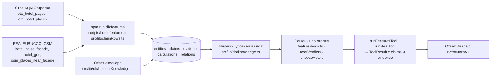
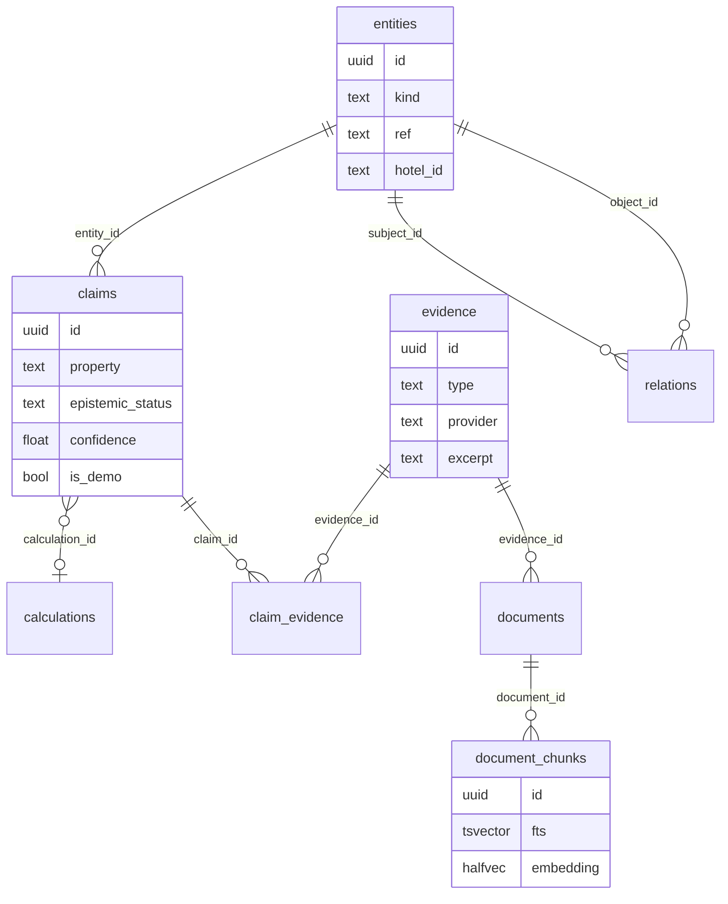
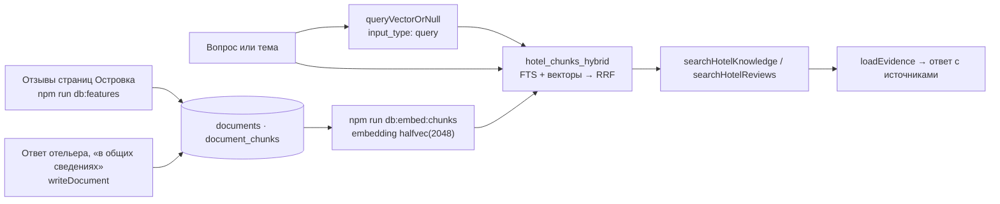
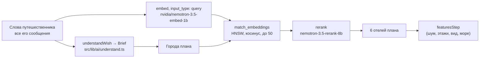
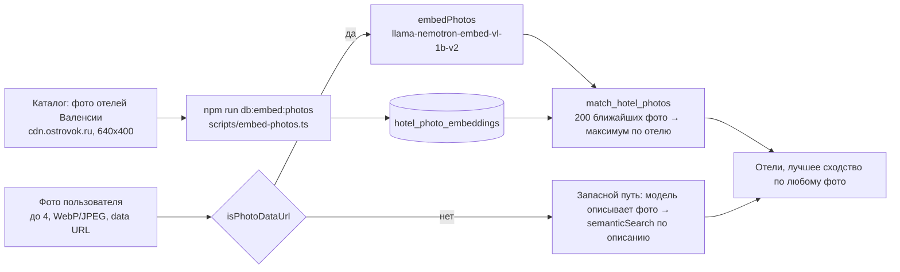

# Знания и поиск: KAG, RAG, поиск по смыслу и по фото

Как Эвал находит отели и откуда берёт факты. Четыре части, у каждой свои таблицы и модули:

| Часть                                     | Что отвечает на вопрос                       | Где хранится                                                  |
| ----------------------------------------- | -------------------------------------------- | ------------------------------------------------------------- |
| [KAG](#1-kag-граф-знаний)                 | «Тихо ли ночью», «что рядом», «какой этаж»   | `entities`, `claims`, `evidence`, `calculations`, `relations` |
| [RAG](#2-rag-фрагменты-и-гибридный-поиск) | «Что пишут гости», «что ответил отельер»     | `documents`, `document_chunks`                                |
| [Поиск по смыслу](#3-поиск-по-смыслу)     | «Тихий хостел с быстрым Wi‑Fi в Праге»       | `embeddings`                                                  |
| [Поиск по фото](#4-поиск-по-фото)         | «Найти похожие отели» по снимку пользователя | `hotel_photo_embeddings`                                      |

Модели и ключи — в [«Поиск и ИИ»](search-and-ai.md#модели); загрузка данных — в [«Данные и скрипты»](data-and-scripts.md).
Реальные данные есть только у отелей Валенсии (`ota-<master_id>`): у остальных (демо-каталог) нет ни claims, ни отзывов,
ни векторов фото, и Эвал так и говорит — «нет данных», а не «подходит» или «не подходит».

Общий принцип: любая часть может не ответить (нет ключа, таймаут, пустая таблица). Тогда Эвал работает по правилам без
модели и не показывает путешественнику ошибку; число, единицу измерения и источник в ответ кладёт код, а не языковая модель.

## Оглавление

- [1. KAG: граф знаний](#1-kag-граф-знаний)
  - [Поток данных](#поток-данных)
  - [Таблицы и функции](#таблицы-и-функции)
  - [Схема таблиц](#схема-таблиц)
  - [Уверенность: политика `confidence-1`](#уверенность-политика-confidence-1)
  - [Методы расчёта](#методы-расчёта)
  - [Как Эвал подбирает отели по характеристикам](#как-эвал-подбирает-отели-по-характеристикам)
  - [Ограничения](#ограничения)
- [2. RAG: фрагменты и гибридный поиск](#2-rag-фрагменты-и-гибридный-поиск)
  - [Поток данных](#поток-данных-1)
  - [Таблицы и функции](#таблицы-и-функции-1)
  - [Модули](#модули)
  - [Как фрагменты попадают в ответ](#как-фрагменты-попадают-в-ответ)
  - [Ограничения](#ограничения-1)
- [3. Поиск по смыслу](#3-поиск-по-смыслу)
  - [Поток данных](#поток-данных-2)
  - [Таблицы и функции](#таблицы-и-функции-2)
  - [Что эмбеддится](#что-эмбеддится)
  - [Модели и параметры](#модели-и-параметры)
  - [Как сочетается с правилами без модели](#как-сочетается-с-правилами-без-модели)
  - [Ограничения](#ограничения-2)
- [4. Поиск по фото](#4-поиск-по-фото)
  - [Поток данных](#поток-данных-3)
  - [Таблицы и функции](#таблицы-и-функции-3)
  - [Модули и параметры](#модули-и-параметры)
  - [Качество](#качество)
  - [Ограничения](#ограничения-3)

## 1. KAG: граф знаний

### Поток данных

### Таблицы и функции

Миграция `20261027220000_claims_evidence_store.sql` (каждая таблица доступна на чтение `anon` и `authenticated`, пишет
сервисный ключ); `entities.metadata` (точка места) — `20261028170000_entities_metadata.sql`.

| Таблица          | Что в ней                                                                                                                                                                                        |
| ---------------- | ------------------------------------------------------------------------------------------------------------------------------------------------------------------------------------------------ |
| `entities`       | то, о чём утверждения: `hotel` (`ota-<id>`), `building`, `room`, `osm_place`, `ota_poi`; уникальна пара `(kind, ref)`                                                                            |
| `claims`         | одно значение об одной сущности: число, диапазон `value_min`/`value_max`, текст, булево или JSON; `property` вида `noise.lnight.…`                                                               |
| `evidence`       | источник: `dataset`, `osm`, `review`, `ota_page`, `calculation`, `hotelier` (`20261028140000_hotelier_knowledge.sql`); `excerpt` — слова источника                                               |
| `claim_evidence` | связь утверждения с источниками, роль `source` или `input`                                                                                                                                       |
| `calculations`   | расчёт отдельно от данных: `method`, `version`, `inputs`, `parameters`, `limitations`                                                                                                            |
| `relations`      | рёбра графа `subject —predicate→ object`; в коде есть `near` (отель — место) и `nearest_building` (отель — здание EUBUCCO); значение ребра (расстояние) — его `claim`, источник — его `evidence` |

### Схема таблиц

Статус утверждения (`epistemic_status`): `observed` (измерено, увидено), `reported` (источник сообщает: карта EEA, отзыв
гостя, ответ отельера), `derived` (посчитано; тогда задан `calculation_id`), `inferred` (вывод модели). Противоречащие
утверждения лежат отдельными строками, ничего не сливается. `is_demo` у `claims` и `evidence` помечает демо-данные
отельера (`20261028140000_hotelier_knowledge.sql`).

### Уверенность: политика `confidence-1`

`src/lib/confidence.ts`. Утверждение из источника получает его доверие, расчёт — наименьшее доверие входов минус штраф за
каждое допущение, не ниже 0, с точностью до 0,01. `method.confidence` в утверждении называет версию политики и правило.

Доверие источников (`SOURCE_CONFIDENCE`):

| Источник                    | Доверие |
| --------------------------- | ------- |
| Островок, OSM               | 1       |
| EEA (карта шума), EUBUCCO   | 0,9     |
| отзыв гостя, ответ отельера | 0,75    |
| вывод модели                | 0,5     |

Штрафы за допущения (`ASSUMPTION_PENALTY`): `osm_complete` (в OSM есть все места категории) 0,1; `evening_equals_day` 0,05;
`day_not_quieter_than_night` 0,05; `venue_reference_level` (типовой уровень заведения) 0,2; `point_source_no_screening`
(точечный источник, экранирует только здание отеля) 0,1.

Правила по видам утверждений — `CONFIDENCE_RULES` в том же файле.

### Методы расчёта

- **`noise-estimate-v2`** (`noiseEstimate` в `src/lib/noise.ts`, строки — `estimateStore` в `src/lib/claimRows.ts`). Фасад на
  улицу и окна во двор днём (07–19), вечером (19–23) и ночью (23–07): полосы EEA (`hotel_noise_facade`, контур здания
  EUBUCCO расширен на `FACADE_BUFFER_M` = 5 м) плюс бары, клубы, рестораны, кафе и фастфуд OSM в радиусе `NOISY_RADIUS_M` =
  200 м (`osm_places_near_facade`) как точечные источники: `L = Lref − 20·lg(d/10)`, `d` — от стены здания отеля, не меньше
  3 м, уровни складываются по энергии. Заведения добавляются к улице, не ко двору. Lday из Lden и Lnight — по директиве
  2002/49/EC. Параметры и ограничения записаны в `calculations` (`ESTIMATE_PARAMETERS`, `ESTIMATE_LIMITATIONS`).
- **Расстояние от фасада**: `osm_distance_facade` — от стены здания (EUBUCCO) до формы места OSM; без здания — от точки отеля.
- **Места рядом** (`nearbyStore`, `placesStore`): ребро `near`, категории `NEARBY_CATEGORIES` (аптека, супермаркет,
  больница, остановка, трамвай, метро, вокзал, пляж, парк), радиус `NEARBY_RADIUS_M` = 1000 м, до 5 мест категории.
- **Здание**: `building.height` и этажи — ближайшее здание EUBUCCO в `BUILDING_RADIUS_M` = 50 м от точки отеля.

### Как Эвал подбирает отели по характеристикам

Два пути, они не заменяют друг друга.

**Шаги хода** (`src/lib/ai/turn.ts`, `TURN_STEPS = [searchStep, featuresStep]`). `searchStep` — поиск по смыслу
([часть 3](#3-поиск-по-смыслу)). `featuresStep` работает по `hotel_features` (`src/lib/features.ts`): расстояние до моря,
шум (`lnight`), этажность, вид из названий номеров. Критерии идут по порядку `sea → quiet → height → view`; если ни один
отель не подходит под все, шаг отпускает последние по одному, но не море: «ни одного ближе N к морю» — это ответ.
Критерии, по которым нет данных ни у одного отеля, попадают в `missing`, и Эвал говорит об этом. Порядок среди подходящих:
номер с нужным видом, самая тихая ночная полоса, самое высокое (или низкое) здание, ближе к морю; при равенстве — порядок
поиска по смыслу.

**Инструменты хранилища** (`src/lib/ai/knowledgeTurn.ts`, `src/lib/ai/knowledgeTools.ts`). Если в запросе есть шум, место
рядом или отзывы, модель цепочки выбирает вызовы инструментов с параметрами (tool calling), а без модели или в срок
`KNOWLEDGE_PLAN_MS` = 4 с вызовы выбирают правила по словам запроса. Не больше `MAX_KNOWLEDGE_CALLS` = 5 вызовов, каждый
запуск — до `KNOWLEDGE_RUN_MS` = 5 с. В этом режиме `featuresStep` не использует «тихо» (`featureBrief`), его решает
инструмент.

| Инструмент (`ToolResult`)                                            | Решение по отелю                                                                                                                                     |
| -------------------------------------------------------------------- | ---------------------------------------------------------------------------------------------------------------------------------------------------- |
| `hotels_by_features` («Отели по характеристикам», `runFeaturesTool`) | ночь `noise.estimate.street.lnight` ниже порога `nightBelowDb`, день `…lday` ниже `dayBelowDb`, высота `building.height` в `heightMinM`…`heightMaxM` |
| `nearby_places` («Места рядом», `runNearTool`)                       | ближайшее ребро `near` категории не дальше радиуса (по умолчанию `NEAR_DEFAULT_RADIUS_M` = 500 м, не более `NEAR_MAX_RADIUS_M` = 1000 м)             |
| `hotel_reviews` («Отзывы», `runReviewsTool`)                         | фрагменты отзывов по теме, см. [RAG](#2-rag-фрагменты-и-гибридный-поиск)                                                                             |

Правила и пороги `hotels_by_features`:

- «Тихо ночью» — `QUIET_NIGHT_DB` = 50 дБ: верхняя граница оценки у фасада на улицу ниже 50. Открытая полоса считается самой
  громкой. Граница сравнивается строго: `<`.
- Вердикт критерия: `match`, `miss` или `nodata`. Отель с `miss` по любому критерию — `miss`, иначе с `nodata` — `nodata`
  («нет данных»), иначе `match`. Отели без данных не отбираются и не отбрасываются.
- Результат (`chooseHotels`, до `SHOWN_HOTELS` = 6): отели, у которых все инструменты дали `match`; если таких нет — те, у
  кого нет `miss` и есть хоть один `match` (ответ помечен как неполный). Порядок: ночь, затем день (тише — выше), затем
  порядок кандидатов.
- «Данные неполные» — если часть чтений утверждений выбранных отелей не ответила (`incomplete`), в `summary` и в
  `limitations` появляется эта фраза, а в блоке может быть показано меньше, чем есть. Не удалось прочитать индекс —
  `errorResult('store_unavailable', …)`, инструмент никогда не бросает исключение.
- Сведения отельера: если у отеля нет ночного уровня EEA, а все текущие ответы отельера о шуме читаются правилами как «тихо»
  (`noiseWords`: «тих», «бесшум» — тихо; «шумн», «громк» — шумно; отрицание, оба слова или ни одного — неизвестно), порог
  50 дБ и выше засчитывается как `match`. В блоке такое утверждение подписано «со слов отельера» и, если оно демо, «демо».
  Если ответы отельера расходятся или отозваны, они не учитываются.

Сведения отельера в графе (`src/lib/db/hotelierKnowledge.ts`): утверждения `hotelier.*` со статусом `reported`,
уверенностью 0,75 (правило `owner_answer`), ответом как `evidence` (`type = 'hotelier'`, провайдер «Отельер»). Более
поздний ответ о той же характеристике закрывает прежнее утверждение (`valid_to`), «Отозвать сведения» закрывает свои. Для
демо-отельера стоит `is_demo`, и везде, где эти данные показаны, есть пометка «демо».

### Ограничения

- Данные только у Валенсии; в остальных городах `hotels_by_features` и `nearby_places` отвечают «нет данных».
- Карты шума EEA — модель раунда 2022 года в полосах по 5 дБ, не измерение. Окна и стены не снижают уровень.
- Заведения OSM имеют типовой уровень (`VENUE_LEVELS`), а не измеренный; OSM может не знать часть заведений.
- Между отелем и местом строится только ребро `near`; других предикатов, кроме `nearest_building`, в коде нет.
- Индексы уровней и мест (`loadLevelIndex`, `loadNearIndex`) — несколько тысяч коротких строк, кешируются вместе с каталогом.

## 2. RAG: фрагменты и гибридный поиск

### Поток данных

### Таблицы и функции

Миграции `20261027220000_claims_evidence_store.sql` (таблицы) и `20261028140000_hotelier_knowledge.sql`
(`hotel_chunks_hybrid`, `content_hash`, вид документа `hotelier_answer`).

- `documents` — текст целиком, один на `evidence`; `kind` — `review` или `hotelier_answer`. Это недоверенный текст: его
  цитируют как данные, инструкций в нём нет.
- `document_chunks` — части документа: заголовок, «Понравилось», «Не понравилось» или текст отзыва, фрагмент не длиннее
  `CHUNK_CHARS` = 2000 символов, режется по предложениям (`chunksOf`). Колонки: `fts` (`tsvector`, словарь `russian`,
  индекс GIN), `embedding halfvec(2048)`, `content_hash`. Индекса HNSW по `document_chunks.embedding` нет: сравнение идёт
  только среди фрагментов одного отеля.
- `hotel_chunks_hybrid(hotel_id, query, query_embedding default null, max_rows default 10)` — `security invoker`, права
  `anon`, `authenticated`, `service_role`. Запрос режется до 500 символов, разбирается `websearch_to_tsquery('russian', …)`.
  Два ранжирования, в каждом не больше 50 фрагментов: полнотекстовое (`ts_rank`) и по косинусу (только для фрагментов с
  вектором и только если передан `query_embedding`). Слияние RRF: `rank = Σ 1/(60 + место)`. Без вектора — только слова.
  Возвращает `rank`, `fts_place`, `vector_place`; `max_rows` не больше 50.
- Функция `hotel_chunks_search` (только слова) удалена в `20261029130000_hotelier_column_grants_drop_chunks_search.sql`.

### Модули

| Файл                                                     | Что делает                                                                                                                                                               |
| -------------------------------------------------------- | ------------------------------------------------------------------------------------------------------------------------------------------------------------------------ |
| `src/lib/claimRows.ts` (`reviewStore`)                   | отзыв → документ, фрагменты, утверждения `noise.review.mention` (`review_mention`, 0,75) с `excerpt` до 300 символов                                                     |
| `scripts/embed-chunks.ts`                                | `npm run db:embed:chunks`: векторы фрагментов без `content_hash` или с изменённым текстом, пачки по 32, 40 запросов в минуту                                             |
| `src/lib/db/hotelierKnowledge.ts`                        | ответ отельера → документ `hotelier_answer`, фрагмент на каждую характеристику; вектор считается сразу, без ключа фрагмент находят по словам и доберут `db:embed:chunks` |
| `src/lib/ai/semantic.ts` (`queryVectorOrNull`)           | вектор запроса `input_type: query`; ждёт `HYBRID_VECTOR_MS` = 4 с, иначе `null` — поиск только по словам; кеш 500 запросов                                               |
| `src/lib/db/claims.ts`                                   | `searchHotelKnowledge` (вызывает функцию, до 50 фрагментов), `searchHotelReviews` (только `review` и только если в тексте есть слова темы), `loadEvidence`               |
| `src/app/api/hotels/[hotelId]/documents/search/route.ts` | `GET /api/hotels/{hotelId}/documents/search?q=…` — те же фрагменты с источником                                                                                          |

### Как фрагменты попадают в ответ

- **Инструмент «Отзывы»** (`runReviewsTool`). Тема — одна из шума, чистоты, персонала, завтрака, кровати и сна,
  расположения. Слова темы идут в полнотекстовую часть (`REVIEW_QUERY`, формы слов перечислены, потому что стеммер не
  сводит «шумно» к «шум»); смысловая часть эмбеддит подпись темы. Показываются фрагменты, где тема названа словами
  (`TOPIC_MENTION`): фрагмент, близкий только по смыслу, не цитируется как «об этом». Не больше `REVIEWS_PER_HOTEL` = 2
  фрагментов на отель, из разных отзывов. Источники — `evidence` фрагментов, у каждого `title`, `provider`, `excerpt`. В
  `limitations` инструмент честно пишет, что отзыв — слова одного гостя, а без модели векторов поиск идёт только по словам.
- **«Анализ шума»** (`src/lib/ai/noiseTool.ts`) берёт упоминания шума из отзывов тем же `searchHotelReviews` с `NOISE_MENTION`.
- **Посредник отеля** (`src/lib/ai/hotelierMediator.ts`). После сообщения путешественника в чате с отелем
  (`after()`): вектор вопроса за 6 с, `searchHotelKnowledge(hotel.id, вопрос, 6, вектор)` — до `KNOWLEDGE_CHUNKS` = 6 фрагментов,
  среди них отзывы и прежние ответы отельера. Вместе с данными Островка, утверждениями отельера (`loadHotelierClaims`) и
  шумом они попадают в промпт; модель отвечает JSON `{ decision, answer, claim_ids, chunk_ids, hotel_data }` и ссылается на
  утверждения `[C…]` и фрагменты `[D…]`. Если данные противоречат друг другу или их нет — `escalate`, вопрос уходит отельеру.
  Всегда уходят отельеру вопросы о свободных номерах, ценах, гарантированном виде и индивидуальных условиях
  (`needsHotelier`). Пока отельер отвечал в последние `HOTELIER_ACTIVE_MS` = 10 минут, посредник молчит. Ответ — не длиннее 600
  символов, с источниками.

### Ограничения

- Документы только двух видов: `review` и `hotelier_answer`; других источников в хранилище нет.
- Реранкера в гибридном поиске нет: порядок задаёт RRF.
- Фрагмент без вектора не пропадает: его находит полнотекстовая часть.
- Язык запроса — русский (словарь `russian`); латинские слова идут в английский стеммер.
- Отзывы есть у отелей Валенсии с загруженными страницами Островка (`npm run db:load:ota-pages`, затем `npm run db:features`).

## 3. Поиск по смыслу

### Поток данных

Подготовка индекса: `hotels` + `hotel_features` + страницы Островка → `hotelDocument` → `npm run db:embed` → `embeddings`.

### Таблицы и функции

Миграция `20261022150000_embeddings.sql`.

- `embeddings(kind, ref_id, destination_id, model, content_hash, content, embedding halfvec(2048))`, ключ `(kind, ref_id)`;
  индекс HNSW `halfvec_cosine_ops`. Таблица закрыта (`revoke all`, RLS): читают её только функции `security definer`, пишет
  сервисный ключ. В комментарии миграции ещё названа модель `nemotron-3.5-embed-8b`: сейчас вектора делает `…embed-1b`.
- `match_embeddings(query_embedding, match_kind, destination_ids, match_count)` — ближайшие по косинусу, не больше 100.
- Функция `similar_hotels` из той же миграции удалена в `20261027200000_drop_unused_functions.sql`: вызывать её было некому.

### Что эмбеддится

`scripts/embed.ts` (`npm run db:embed`) для каждого отеля строит текст `hotelDocument` (`src/lib/ai/documents.ts`): тип и
название, звёзды, город и его темы, рейтинг и число отзывов, цену от, Wi‑Fi и рабочую зону, расстояние до центра,
характеристики (`featureLines`: здание, шум, виды номеров), описание, удобства по группам, до 8 ближайших мест страницы
Островка, «настроение» по осям поиска вайба и до 3 отзывов (только у демо-отелей: у настоящих показываются данные Островка,
своих отзывов в строке нет). В модель идут только новые и изменённые тексты (`content_hash` включает модель и размерность),
вектора удалённых отелей стираются. Параметры: пачка `BATCH` = 32, не больше 40 запросов в минуту.

### Модели и параметры

| Что              | Значение                                                                                                                                |
| ---------------- | --------------------------------------------------------------------------------------------------------------------------------------- |
| Эмбеддинги       | `nvidia/nemotron-3.5-embed-1b`, `input_type` `query` для запроса и `passage` для документа, `truncate: END` (`src/lib/ai/embedding.ts`) |
| Размерность      | 2048 (`EMBEDDING_DIMENSIONS`), `halfvec(2048)`; более длинный вектор обрезается до 2048 и нормируется                                   |
| Реранк           | `nvidia/nemotron-3.5-rerank-8b`, оценка — логит (`src/lib/ai/rerank.ts`)                                                                |
| `semanticSearch` | `k` = 5 по умолчанию (ход Эвала берёт `MATCHES` = 6), `candidates` = 30 (не больше `MAX_CANDIDATES` = 50), запрос до 1000 символов      |
| Срок             | `SEMANTIC_TIMEOUT_MS` = 8 с на весь поиск; повтор в ходе Эвала, если до срока ответа остаётся минимум 1,5 с                             |

### Как сочетается с правилами без модели

1. Путешественник пишет свободно. Языковая модель цепочки (GigaChat → NVIDIA, см. [«Модели»](search-and-ai.md#модели))
   разбирает сообщение в бриф: город, тема, даты, состав, бюджет в валюте, «тихо», «повыше», вид. Поле, которого в тексте нет,
   остаётся пустым: `grounded` отбрасывает значения, которых правила не видят в тех же словах. Без модели бриф строят правила
   `parseWish` (`src/lib/assistant.ts`).
2. Когда бриф полон, `searchStep` ищет по **всем** словам путешественника в городах плана и отдаёт 6 отелей. Фильтр — города
   плана (`destination_ids`), плюс только видимые отели (`isVisibleHotel`) и не вне карт шума (`loadHiddenHotelIds`).
3. Реранкер выбирает порядок. Упал только он — порядок остаётся векторным. Нет ключа, нет векторов, ошибка или таймаут —
   `failed` с причиной (`no-key`, `timeout`, `aborted`, `model`, `database`), и план остаётся на правилах каталога.
4. `featuresStep` затем проверяет подобранные отели по данным ([часть 1](#как-эвал-подбирает-отели-по-характеристикам)):
   поиск по смыслу даёт порядок и кандидатов, характеристики — жёсткие условия.
5. Если поиск по смыслу не ответил и повтор не удался, Эвал отвечает по правилам и пишет, что модели недоступны
   (`semanticDown`, `modelsDown`).

Качество: `node --env-file=.env scripts/semantic-eval.ts` (15 запросов, попадания в top-5 по векторам и после реранка; вне CI).

### Ограничения

- Вектор на отель один и общий: он не знает, какой из номеров тихий и с каким видом, — это решают claims.
- Вектора отелей не обновляются сами: после изменения данных нужен `npm run db:embed`.
- Кеш вектора запроса живёт в памяти процесса (500 записей), не общий между инстансами.
- Лимит ключа NVIDIA — 40 запросов в минуту на всё: поиск, чат, скрипты.

## 4. Поиск по фото

### Поток данных

### Таблицы и функции

Миграция `20261029120000_hotel_photo_embeddings.sql`.

- `hotel_photo_embeddings(hotel_id, photo_key, destination_id, content_hash, embedding halfvec(2048))`, ключ
  `(hotel_id, photo_key)`; HNSW `halfvec_cosine_ops` и индекс по `destination_id`. Внешнего ключа на `hotels` нет:
  пересборка `hotels` не стирает векторы, сирот удаляет скрипт. Таблица закрыта для `anon` и `authenticated`.
- `match_hotel_photos(query_embedding, destination_ids, match_count)` — `security definer`. Индекс HNSW даёт 200 ближайших
  фото, из них собираются отели: `similarity = 1 − расстояние ближайшего фото отеля` (максимум по отелю), `match_count` не
  больше 100.

### Модули и параметры

| Файл                                             | Что делает                                                                                                                                                                                                                                                                                                                                     |
| ------------------------------------------------ | ---------------------------------------------------------------------------------------------------------------------------------------------------------------------------------------------------------------------------------------------------------------------------------------------------------------------------------------------- |
| `src/lib/ai/photoEmbedding.ts`                   | `nvidia/llama-nemotron-embed-vl-1b-v2` (`PHOTO_EMBEDDING_MODEL`), 2048 чисел, `input_type: passage` и для каталога, и для запроса; не больше `PHOTO_BATCH` = 4 фото на запрос; `photoKey` — путь на CDN без размера; `PHOTO_CITIES = ['valencia']`                                                                                             |
| `scripts/embed-photos.ts`                        | `npm run db:embed:photos`: все фото отелей Валенсии по разу, размер 640x400, WebP/JPEG; идемпотентен по `content_hash` (модель, размерность, ключ фото); фото без `url`, не того типа и отклонённые моделью (422) пропускаются и считаются; фото, которых нет в каталоге, удаляются; `--dry-run` только считает; около 2000 фото — 12–15 минут |
| `src/lib/ai/photoSearch.ts`                      | `searchHotelsByPhotos`: вектор каждого фото, `match_hotel_photos` по Валенсии (`match_count` 12), лучшее сходство на отель по всем фото, видимые отели, `k` лучших; таймаут `SEMANTIC_TIMEOUT_MS` = 8 с                                                                                                                                        |
| `src/app/api/assistant/route.ts` (`similarTurn`) | выбор «Найти похожие отели» / «Учесть в запросе» (`photoIntent`: правила по словам, затем текстовая модель), поиск по вектору, запасной путь                                                                                                                                                                                                   |

Проверка фото пользователя (недоверенный ввод): `isPhotoDataUrl` — только `data:image/webp|jpeg;base64,…` не длиннее
`MAX_PHOTO_URL_LENGTH` = 1 400 000 символов, не больше `MAX_PHOTOS` = 4. Иное не доходит до модели: поиск возвращает
`failed('model')`.

Запасной путь: если в брифе город не Валенсия, поиск по вектору не ответил или ничего не нашёл — модель, которая видит фото
(`seePhotos`, `src/lib/ai/vision.ts`), описывает снимок, и Эвал ищет по описанию обычным [поиском по смыслу](#3-поиск-по-смыслу)
(основной запрос и один повтор другими словами).

### Качество

Замер до внедрения (`openspec/changes/archive/2026-10-28-hotel-photo-vectors/proposal.md`): фото из индекса против другого
фото того же отеля, Валенсия.

| Выборка             | top-1 | top-5 |
| ------------------- | ----- | ----- |
| 120 отелей × 3 фото | 42 %  | 58 %  |
| 30 отелей × 4 фото  | 53 %  | 82 %  |

Старый поиск по описанию фото на 12 тестовых снимках не находил свой отель ни разу (0 из 12). `nvidia/nemotron-3.5-embed-1b`
фото принимает, но хуже (25 % и 39 % на 120 отелях); `nvidia/nvclip` для нашего ключа недоступна (404). Замер — разовый,
скрипта для его повторения в репозитории нет.

### Ограничения

- Только Валенсия (`PHOTO_CITIES`); векторы появляются после `npm run db:embed:photos`, который в `make seed` входит последним шагом.
- Поиск ищет похожие снимки, а не проверяет факты: «вид на море» на фото не становится утверждением в графе знаний.
- Фото в каталоге — только то, что отдаёт CDN Островка в WebP или JPEG; остальные пропускаются.
- Вектор фото пользователя считается на лету и в `hotel_photo_embeddings` не пишется (сами фото в чате — вложения в Storage, миграция `20261025120000_assistant_attachments.sql`).

[← README](../README.md)
